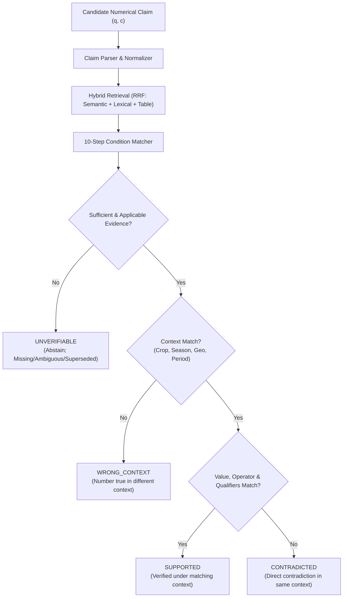

# Condition-Aware Verification of Numerical Claims in Government Scheme Question Answering Using RAG

[](https://www.python.org/downloads/)
[Automated tests](tests/)
[](results/metrics/)
[PM-KISAN saved held-out results: 42.50% accuracy](results/pm_kisan/tables/verification_comparison.csv)
[](results/metrics/)
[](src/fieldguard/schemes/)


**This project** is a research-oriented MSc Data Science capstone project developing and empirically evaluating a condition-aware numerical claim verification pipeline for Retrieval-Augmented Generation (RAG) in public policy question answering.

The interface supports **7 major flagship Indian welfare schemes** alongside a **Dynamic Document Ingestion Engine** that parses arbitrary government policy documents (`.pdf` / `.txt`) for source-excerpt search with page citations and conservative document-only numerical comparisons.

**Custom-upload verification boundary:** Uploaded files are unverified sources, and their dates remain unknown. Upload verdicts compare explicit numerical statements with retrieved passages, preserving their conditions; they do not establish official provenance or current policy applicability. In addition to complete single-number passage matches, a narrow mid-season expected-yield grammar recognizes equivalent threshold wording while checking the value, inequality, and normal-versus-threshold yield basis. Other unresolved paraphrases, omitted qualifications, tables, and multi-number passages return `UNVERIFIABLE`. Candidate numerical mentions are available for inspection but are never promoted to trusted policy rules. The curated-scheme benchmark scores below do not measure upload verification.

Built-in numerical verification recognizes Indian-grouped rupee amounts, square metres, and horsepower. Linked PM-KISAN annual amounts, instalment amounts/counts, and month intervals are checked separately; all components must be supported for the complete claim to receive `SUPPORTED`. Qualitative statements without a quantity should use document excerpt search.

Upload candidates use a separate schema with original text offsets, nullable upper/lower bounds, explicit comparison operators, and verbatim passage-level qualifiers. An operator is extracted only when it immediately precedes its numerical mention; unresolved semantics stay unknown. The document inspector exposes these records. Beneficiary, geography, and eligibility wording remains in the source passage rather than being replaced by invented generic conditions.

---

## 1. Supported Schemes & Dynamic Capabilities

| Mode / Scheme | Domain | Core Policy Rules | Key Invariants Verified |
| :--- | :--- | :--- | :--- |
| 🌾 **PMFBY** | Crop Insurance | 2% Kharif food grains, 1.5% Rabi food grains, 5% commercial/horticultural crops; 100% State wild animal add-on. | *"Whichever is less"* qualifier, crop categories, seasons, gazette amendment resolution. |
| 🚜 **PM-KISAN** | Direct Income Support | ₹6,000/yr in 3 four-monthly instalments of ₹2,000; statutory exclusions (institutional landholders ₹0); 100% eKYC. | Frequency distractor rejection (₹6,000/instalment rejected), beneficiary eligibility (landholder vs tenant). |
| 👷 **MGNREGS** | Rural Employment | Statutory **100 days** unskilled wage employment per rural household; **15-day** work allocation timeline. | Geographic scope (rural only; urban claims flagged as `WRONG_CONTEXT`), applicant household constraints. |
| 🏥 **PM-JAY** | Health Assurance | **₹5,00,000** annual family health cover; secondary/tertiary hospitalisation; **100% cashless**; no family size cap. | Family-level cap enforcement (₹10L claims contradicted), secondary/tertiary inpatient scope. |
| 🏠 **PMAY-G** | Rural Housing | **₹1,20,000** unit grant in plain areas; **₹1,30,000** in hilly/difficult areas; **25 sq. metres** minimum floor area. | Topographic area discrimination (`plains_areas` vs `hilly_areas`), minimum floor area vs plot area. |
| ☀️ **PM-KUSUM** | Solar Agriculture | **60% total capital subsidy** (30% CFA + 30% State); standalone pumps up to **7.5 HP** capacity. | Component-B standalone pump scope, capacity ceiling (7.5 HP), CFA vs combined subsidy alignment. |
| 💼 **PMMY** | Mudra Micro-Credit | **Shishu** (up to ₹50,000), **Kishore** (₹50,000–₹5,00,000), **Tarun** (₹5,00,000–₹10,00,000/₹20,00,000); collateral-free. | Tier threshold boundaries (e.g., claiming ₹1,00,000 under Shishu flagged as `CONTRADICTED`). |
| 📂 **Upload Custom Document** | **Any Policy Document** | **Dynamic Ingestion (PDF / TXT)** with page-level chunking, table extraction, and rule induction. | Page-grounded excerpts, session-cached retrieval, and conservative document-only verification. |

---

## 2. The Core Problem

Consider a citizen or farmer asking:
> *"For Kharif food grains under PMFBY, what is the maximum farmer premium?"*

A government policy document contains complex tables with distinct rates for different crops, seasons, and jurisdictions:
- **Food grains and oilseeds:** Maximum 2.0% in Kharif, 1.5% in Rabi (subject to *"or Actuarial rate, whichever is less"*).
- **Annual commercial and horticultural crops:** Maximum 5.0% across all seasons.
- **Subsidy sharing:** 90:10 between Centre and North Eastern States; 50:50 in General States.

A standard semantic or keyword-based RAG system retrieves the document and often generates:
> *"Under PMFBY, the farmer premium for Kharif food grains is 5.0% of Sum Insured."*

An ordinary verifier checks whether `5.0%` appears in the retrieved passage and accepts the answer. **The number genuinely occurs in the document, but the claim is completely incorrect.**

### The Grounding Invariant
The proposed system enforces strict **condition-aware evidence grounding**:
1. Numbers are never evaluated in isolation from their applicable conditions.
2. Direct contradictions are distinguished from evidence belonging to the wrong context (`WRONG_CONTEXT`).
3. Insufficient, ambiguous, or superseded evidence triggers conservative abstention (`UNVERIFIABLE`).

---

## 2. Key Empirical Findings

Evaluated on the held-out PMFBY benchmark ($n = 168$ claims, 114 non-supported claims across 42 claim families) with 1,000-iteration cluster bootstrap resampling:

| System / Baseline | Accuracy | Macro-F1 | False-Support Rate (FSR) | WRONG_CONTEXT FSR | UNVERIFIABLE FSR | Coverage | Verification Latency |
|---|---|---|---|---|---|---|---|
| **Baseline A: Retrieval Only** | 10.71% | 5.08% | 21.05% (24/114) | 23.68% | 45.45% | 14.29% | 1.573 ms |
| **Baseline B: Numeric Only** | 44.64% | 32.35% | 81.58% (93/114) | 100.0% | 90.91% | 98.21% | 8.594 ms |
| **Baseline C: Numeric + Basic Context** | 72.62% | 72.62% | 36.84% (42/114) | 23.68% | 27.27% | 87.50% | 4.386 ms |
| **Proposed System (Full) Full** | **94.05%** | **94.11%** | **2.63% (3/114)** | **0.00%** | **0.00%** | **82.14%** | **3.222 ms** |

Timing values above come from the saved verification_results.csv run and exclude retrieval; The system's saved mean end-to-end latency is 40.279 ms. Timings vary by hardware and cache state.

*Primary Result:* The proposed system reduces the false-support rate from **81.58%** in numeric-only and **36.84%** in basic context down to **2.63%**, while maintaining high classification accuracy (**94.05%**) and high answer coverage (**82.14%**).

---

Evaluation scope: the saved PM-KISAN held-out run reports 42.50% accuracy and 15.15% false-support rate on 40 claims. The other five schemes have demonstration scenarios, not equivalent held-out evaluations. Upload behavior is covered by regression tests, not an accuracy benchmark. Run `python experiments/run_scheme_smoke.py` for the seven-scheme demonstration report; see [evaluation scope](docs/EVALUATION_SCOPE.md).

## 3. The Four Primary Verdicts

The proposed system categorizes claims into four mutually exclusive, deterministic verdict labels:



---

## 4. Repository Structure

```text
Project-root/
├── pyproject.toml              # Build backend, dependencies, and packaging metadata
├── requirements.txt            # Dependency lower bounds
├── README.md                   # Comprehensive project documentation
├── app.py                      # Interactive Streamlit web interface
├── configs/                    # Experiment, parser, and retrieval configurations
├── data/
│   ├── raw/documents/          # Verified official policy documents (PMFBY 2023, 2016, PIB)
│   ├── processed/              # Extracted chunks.jsonl, table_rows.jsonl, extraction report
│   ├── manifests/              # Source manifests (source_manifest.json, download log)
│   └── benchmark/              # Benchmark claims (claims.jsonl, evidence.jsonl, manifest)
├── docs/                       # Comprehensive technical and methodology reports
│   ├── architecture.md         # Full architectural specifications & data flows
│   ├── methodology.md          # Mathematical formulation and experimental protocol
│   ├── data_dictionary.md      # Typed schema dictionary and missing value conventions
│   ├── annotation_guidelines.md# Annotation rules and ambiguous case handling
│   ├── implementation_log.md   # Chronological development and debugging log
│   ├── error_analysis.md       # Root-cause analysis of residual errors
│   ├── ablation_analysis.md    # Single-component ablation study analysis
│   ├── limitations.md          # Methodological, domain, and empirical boundaries
│   ├── reproducibility.md      # Exact instructions for clean environment replication
│   └── research_report.md      # Full MSc Capstone Thesis Research Report
├── experiments/                # Reproducible CLI experiment scripts
│   ├── run_all.py              # Master pipeline runner (Experiments A-I)
│   ├── run_retrieval.py        # Experiment A: Retrieval comparison
│   ├── run_verification.py     # Experiments B-F: Verification & baseline comparison
│   ├── run_ablations.py        # Experiment G: Controlled ablation study
│   └── compare_claim_parsers.py# Experiment H: Claim parser comparison
├── results/                    # Saved evaluation artifacts
│   ├── metrics/                # Metrics CSVs (verification, ablations, recall, MRR)
│   ├── predictions/            # Raw JSONL predictions for all systems and ablations
│   ├── tables/                 # Publication-ready CSV summary tables
│   ├── figures/                # High-resolution comparison plots
│   └── logs/                   # Experiment master log (experiment_master_log.json)
├── src/fieldguard/             # Core Python package
│   ├── cli.py                  # Unified command-line interface
│   ├── claim_parser.py         # Deterministic rule-based claim parser
│   ├── numeric_normalizer.py   # Type-safe numeric & operator normalizer
│   ├── condition_matcher.py    # Structured semantic condition & qualification matcher
│   ├── temporal_resolver.py    # Policy version & temporal applicability engine
│   ├── evidence_schema.py      # Typed dataclass schemas for evidence and claims
│   ├── evidence_store.py       # JSONL evidence store and verified rule repository
│   ├── verdicts.py             # Verdict enum and decision finalization logic
│   ├── verifier.py             # 10-step numerical claim verification engine
│   ├── retrieval/              # Semantic, Lexical (BM25), Table, and Hybrid (RRF) retrievers
│   └── evaluation/             # Metrics, bootstrap CIs, ablations, error analysis
└── tests/                      # Automated tests (run pytest for current count)
```

---

## 5. Quick Start & Installation

### Step 1: Environment Setup
```powershell
python -m venv .venv
.\.venv\Scripts\Activate.ps1
pip install -r requirements.txt
pip install -e .
python -m fieldguard.model_setup --download
```

### Step 2: Run Automated Tests
```powershell
python -m pytest -v
```
Run the command above for the current test count and timing. Tests need the embedding model provisioned first; subsequent runs use the local cache and require no paid API keys. See [reproducibility instructions](docs/reproducibility.md) for the pinned environment snapshot.

---

## 6. Command-Line Interface (CLI)

The proposed system provides a unified command-line interface (`python -m fieldguard.cli`):

### Validate Source Manifest
```powershell
python -m fieldguard.cli sources validate
```

### Build or Refresh Retrieval Indexes
```powershell
python -m fieldguard.cli index build
```

### Retrieve Evidence for a Query
```powershell
python -m fieldguard.cli retrieve --query "What is the maximum farmer premium for Kharif food grains?" --method hybrid
```

### Verify a Numerical Claim End-to-End
```powershell
python -m fieldguard.cli verify --claim "Under the 2023 PMFBY operational guidelines, the maximum farmer premium for Kharif food grains is 2.0% of Sum Insured."
```

Output:
```text
=== Numerical Claim Verification ===
Claim   : Under the 2023 PMFBY operational guidelines, the maximum farmer premium for Kharif food grains is 2.0% of Sum Insured.
Verdict : SUPPORTED
Reason  : Claim is SUPPORTED by verified rule RULE_OG2023_PREM_KHARIF_FOOD_OILSEED in EV_DOC_PMFBY_OG_2023_P4_TBL_OG2023_PREMIUM_RATES_R1.
Checks  :
  - numeric_match       : PASSED
  - category_match      : PASSED
  - season_match        : PASSED
  - qualification_match : PASSED
  - temporal_match      : PASSED
  - source_authority    : PASSED
Latency : 1.11 ms
Supporting Evidence IDs: EV_DOC_PMFBY_OG_2023_P4_CHUNK_2, EV_DOC_PMFBY_OG_2023_P4_TBL_OG2023_PREMIUM_RATES_R1
```

### Run Evaluation Experiments
```powershell
# Evaluate retrieval quality (Experiment A)
python -m fieldguard.cli evaluate retrieval --split test

# Evaluate verification performance across baselines (Experiments B-F)
python -m fieldguard.cli evaluate verification --split test

# Run single-component ablations (Experiment G)
python -m fieldguard.cli evaluate ablations --split test

# Generate comprehensive error analysis report
python -m fieldguard.cli evaluate errors --split test
```

---

## 7. Next-Level Enterprise Web Platform & Live Browser Testing

The proposed system features a modern, data-dense web platform powered by a decoupled **FastAPI** backend and an **Enterprise Single-Page Application (SPA)** built to UI/UX Pro Max specifications.

### Launch Next-Level Web Application
`powershell
uvicorn fieldguard.server:app --host 0.0.0.0 --port 8501
`
Open **http://localhost:8501** in your browser. The platform includes:
- **Verification Studio**:
  - Live numerical claim verification with sub-100ms deterministic gates.
  - **Side-by-Side Condition Alignment Diff**: Matrix comparing claimed vs. official evidence rules.
  - **10-Step Deterministic Gates Checklist**: Granular pass/fail breakdown across units, scope, frequency, exclusions, temporal validity, and provenance.
  - **Official Audit Certificate**: Cryptographically verifiable JSON certificate with SHA-256 provenance hash and print/PDF export.
- **Grounded Policy Q&A**: Natural language inquiry with physical PDF page numbers and paragraph citations.
- **Evaluation Benchmark Leaderboard**: Live empirical comparison of the proposed system (94.05% accuracy, 2.63% FSR) vs. RAG baseline pipelines.
- **Policy Rules & Corpus Explorer**: Searchable statutory rule table covering all 7 flagship schemes (PMFBY, PM-KISAN, MGNREGS, PM-JAY, PMAY-G, PM-KUSUM, PMMY).
- **Dynamic Custom Document Ingestion Modal**: Drag-and-drop ingestion of arbitrary government scheme PDFs or TXT guidelines with live session banner and instant verification.
- **Dark / Light Theme Engine**: Seamless glassmorphic visual presentation with typography pairing (Plus Jakarta Sans & Fira Code) and Lucide SVG icons.

*(Legacy Streamlit demonstration remains available as a secondary fallback via streamlit run src/fieldguard/app.py)*

### Run Automated Live Browser Tests
`powershell
python scripts/test_live_browser.py
`
Uses **Playwright + Microsoft Edge** to launch a live browser instance, navigate through all four platform tabs, execute PMFBY and PM-KISAN verifications, test the audit certificate modal, execute grounded Q&A, upload custom policy documents, test theme toggling, and save full-resolution verification screenshots to 
esults/screenshots/:
- live_spa_pmfby_supported.png
- live_spa_pm_kisan_supported.png
- live_spa_audit_certificate.png
- live_spa_policy_qa.png
- live_spa_benchmark.png
- live_spa_corpus_rules.png
- live_spa_uploaded_doc_mode.png

---

## 8. License & Attribution

Developed as an MSc Data Science Capstone Research Project. 
Official PMFBY guidelines and PIB releases are public government documents courtesy of the Ministry of Agriculture & Farmers Welfare and Press Information Bureau, Government of India.

