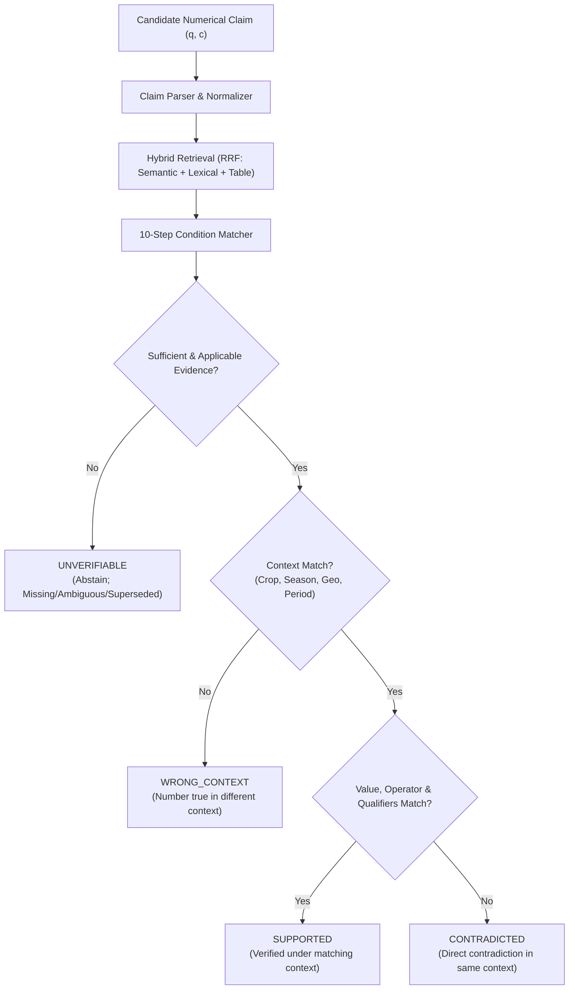

# FieldGuard: Condition-Aware Verification of Numerical Claims in Government-Scheme Question Answering Using RAG

[](https://www.python.org/downloads/)
[](tests/)
[](results/metrics/)
[](results/metrics/)
[](LICENSE)

**FieldGuard** is a research-oriented MSc Data Science capstone project developing and empirically evaluating a condition-aware numerical claim verification pipeline for Retrieval-Augmented Generation (RAG) in public policy and agricultural insurance question answering.

The primary research application focuses on India's flagship agricultural insurance policy: the **Pradhan Mantri Fasal Bima Yojana (PMFBY)**, Ministry of Agriculture & Farmers Welfare, Government of India.

---

## 1. The Core Problem

Consider a citizen or farmer asking:
> *"For Kharif food grains under PMFBY, what is the maximum farmer premium?"*

A government policy document contains complex tables with distinct rates for different crops, seasons, and jurisdictions:
- **Food grains and oilseeds:** Maximum 2.0% in Kharif, 1.5% in Rabi (subject to *"or Actuarial rate, whichever is less"*).
- **Annual commercial and horticultural crops:** Maximum 5.0% across all seasons.
- **Subsidy sharing:** 90:10 between Centre and North Eastern States; 50:50 in General States.

A standard semantic or keyword-based RAG system retrieves the document and often generates:
> *"Under PMFBY, the farmer premium for Kharif food grains is 5.0% of Sum Insured."*

An ordinary verifier checks whether `5.0%` appears in the retrieved passage and accepts the answer. **The number genuinely occurs in the document, but the claim is completely incorrect.**

### The Grounding Invariant
FieldGuard enforces strict **condition-aware evidence grounding**:
1. Numbers are never evaluated in isolation from their applicable conditions.
2. Direct contradictions are distinguished from evidence belonging to the wrong context (`WRONG_CONTEXT`).
3. Insufficient, ambiguous, or superseded evidence triggers conservative abstention (`UNVERIFIABLE`).

---

## 2. Key Empirical Findings

Evaluated on the held-out PMFBY benchmark ($n = 168$ claims, 114 non-supported claims across 42 claim families) with 1,000-iteration cluster bootstrap resampling:

| System / Baseline | Accuracy | Macro-F1 | False-Support Rate (FSR) | WRONG_CONTEXT FSR | UNVERIFIABLE FSR | Coverage | Verification Latency |
|---|---|---|---|---|---|---|---|
| **Baseline A: Retrieval Only** | 10.71% | 5.08% | 21.05% (24/114) | 23.68% | 45.45% | 14.29% | 0.90 ms |
| **Baseline B: Numeric Only** | 44.64% | 32.35% | 81.58% (93/114) | 100.0% | 90.91% | 98.21% | 2.45 ms |
| **Baseline C: Numeric + Basic Context** | 72.62% | 72.62% | 36.84% (42/114) | 23.68% | 27.27% | 87.50% | 1.28 ms |
| **FieldGuard Full** | **94.05%** | **94.11%** | **2.63% (3/114)** | **0.00%** | **0.00%** | **82.14%** | **1.42 ms** |

*Primary Result:* FieldGuard reduces the false-support rate from **81.58%** in numeric-only and **36.84%** in basic context down to **2.63%**, while maintaining high classification accuracy (**94.05%**) and high answer coverage (**82.14%**).

---

## 3. The Four Primary Verdicts

FieldGuard categorizes claims into four mutually exclusive, deterministic verdict labels:



---

## 4. Repository Structure

```text
FieldGuard_ag/
├── pyproject.toml              # Build backend, dependencies, and packaging metadata
├── requirements.txt            # Pinned dependencies
├── README.md                   # Comprehensive project documentation
├── app.py                      # Interactive Streamlit web interface
├── configs/                    # Experiment, parser, and retrieval configurations
├── data/
│   ├── raw/documents/          # Verified official policy documents (PMFBY 2023, 2016, PIB)
│   ├── processed/              # Extracted chunks.jsonl, table_rows.jsonl, extraction report
│   ├── manifests/              # Source manifests (source_manifest.json, download log)
│   └── benchmark/              # Benchmark claims (claims.jsonl, evidence.jsonl, manifest)
├── docs/                       # Comprehensive technical and methodology reports
│   ├── architecture.md         # Full architectural specifications & data flows
│   ├── methodology.md          # Mathematical formulation and experimental protocol
│   ├── data_dictionary.md      # Typed schema dictionary and missing value conventions
│   ├── annotation_guidelines.md# Annotation rules and ambiguous case handling
│   ├── implementation_log.md   # Chronological development and debugging log
│   ├── error_analysis.md       # Root-cause analysis of residual errors
│   ├── ablation_analysis.md    # Single-component ablation study analysis
│   ├── limitations.md          # Methodological, domain, and empirical boundaries
│   ├── reproducibility.md      # Exact instructions for clean environment replication
│   └── research_report.md      # Full MSc Capstone Thesis Research Report
├── experiments/                # Reproducible CLI experiment scripts
│   ├── run_all.py              # Master pipeline runner (Experiments A-I)
│   ├── run_retrieval.py        # Experiment A: Retrieval comparison
│   ├── run_verification.py     # Experiments B-F: Verification & baseline comparison
│   ├── run_ablations.py        # Experiment G: Controlled ablation study
│   └── compare_claim_parsers.py# Experiment H: Claim parser comparison
├── results/                    # Saved evaluation artifacts
│   ├── metrics/                # Metrics CSVs (verification, ablations, recall, MRR)
│   ├── predictions/            # Raw JSONL predictions for all systems and ablations
│   ├── tables/                 # Publication-ready CSV summary tables
│   ├── figures/                # High-resolution comparison plots
│   └── logs/                   # Experiment master log (experiment_master_log.json)
├── src/fieldguard/             # Core Python package
│   ├── cli.py                  # Unified command-line interface
│   ├── claim_parser.py         # Deterministic rule-based claim parser
│   ├── numeric_normalizer.py   # Type-safe numeric & operator normalizer
│   ├── condition_matcher.py    # Structured semantic condition & qualification matcher
│   ├── temporal_resolver.py    # Policy version & temporal applicability engine
│   ├── evidence_schema.py      # Typed dataclass schemas for evidence and claims
│   ├── evidence_store.py       # JSONL evidence store and verified rule repository
│   ├── verdicts.py             # Verdict enum and decision finalization logic
│   ├── verifier.py             # FieldGuardVerifier 10-step verification engine
│   ├── retrieval/              # Semantic, Lexical (BM25), Table, and Hybrid (RRF) retrievers
│   └── evaluation/             # Metrics, bootstrap CIs, ablations, error analysis
└── tests/                      # Automated test suite (51 tests, 100% passing)
```

---

## 5. Quick Start & Installation

### Step 1: Environment Setup
```powershell
python -m venv .venv
.\.venv\Scripts\Activate.ps1
pip install -r requirements.txt
pip install -e .
```

### Step 2: Run Automated Tests
```powershell
python -m pytest -v
```
All **51 tests pass** in under 4 seconds without network dependencies or paid API keys.

---

## 6. Command-Line Interface (CLI)

FieldGuard provides a unified command-line interface (`python -m fieldguard.cli`):

### Validate Source Manifest
```powershell
python -m fieldguard.cli sources validate
```

### Build or Refresh Retrieval Indexes
```powershell
python -m fieldguard.cli index build
```

### Retrieve Evidence for a Query
```powershell
python -m fieldguard.cli retrieve --query "What is the maximum farmer premium for Kharif food grains?" --method hybrid
```

### Verify a Numerical Claim End-to-End
```powershell
python -m fieldguard.cli verify --claim "Under the 2023 PMFBY operational guidelines, the maximum farmer premium for Kharif food grains is 2.0% of Sum Insured."
```

Output:
```text
=== FieldGuard Numerical Claim Verification ===
Claim   : Under the 2023 PMFBY operational guidelines, the maximum farmer premium for Kharif food grains is 2.0% of Sum Insured.
Verdict : SUPPORTED
Reason  : Claim is SUPPORTED by verified rule RULE_OG2023_PREM_KHARIF_FOOD_OILSEED in EV_DOC_PMFBY_OG_2023_P4_TBL_OG2023_PREMIUM_RATES_R1.
Checks  :
  - numeric_match       : PASSED
  - category_match      : PASSED
  - season_match        : PASSED
  - qualification_match : PASSED
  - temporal_match      : PASSED
  - source_authority    : PASSED
Latency : 1.11 ms
Supporting Evidence IDs: EV_DOC_PMFBY_OG_2023_P4_CHUNK_2, EV_DOC_PMFBY_OG_2023_P4_TBL_OG2023_PREMIUM_RATES_R1
```

### Run Evaluation Experiments
```powershell
# Evaluate retrieval quality (Experiment A)
python -m fieldguard.cli evaluate retrieval --split test

# Evaluate verification performance across baselines (Experiments B-F)
python -m fieldguard.cli evaluate verification --split test

# Run single-component ablations (Experiment G)
python -m fieldguard.cli evaluate ablations --split test

# Generate comprehensive error analysis report
python -m fieldguard.cli evaluate errors --split test
```

---

## 7. Interactive Demonstration UI

Launch the Streamlit interactive dashboard:
```powershell
pip install streamlit
streamlit run app.py
```
Provides:
- Interactive scenario selection covering all four canonical verdicts.
- Condition-by-condition check breakdown with status badges.
- Latency reporting and expandable retrieved evidence chunks.

---

## 8. License & Attribution

Developed as an MSc Data Science Capstone Research Project. Distributed under the MIT License.
Official PMFBY guidelines and PIB releases are public government documents courtesy of the Ministry of Agriculture & Farmers Welfare and Press Information Bureau, Government of India.

