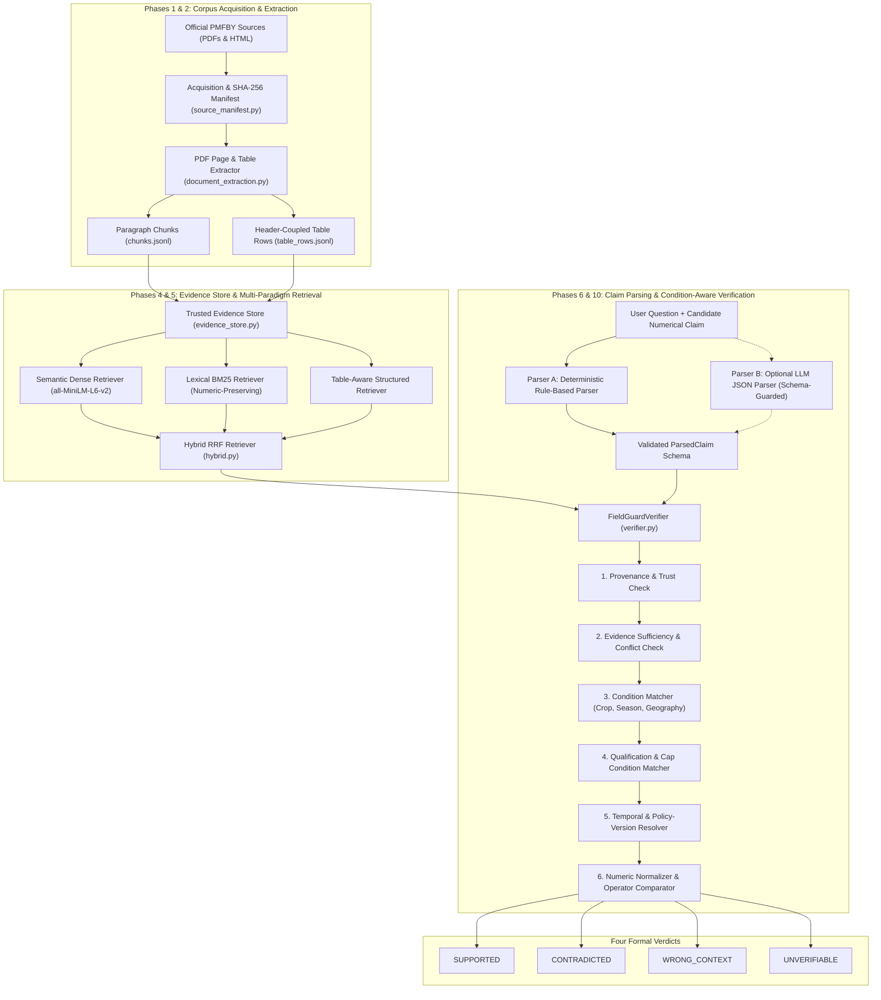

# FieldGuard — System Architecture & Verification Pipeline

## 1. Architectural Overview

**FieldGuard** is a condition-aware numerical claim verification framework designed for government-scheme Question Answering using Retrieval-Augmented Generation (RAG). Unlike standard RAG pipelines or naive numerical fact-checkers that check only whether a claimed number appears somewhere in a retrieved chunk, FieldGuard decomposes every candidate claim and every trusted policy rule into structured semantic, contextual, and temporal dimensions before assigning a formal verdict.

---

## 2. Core Modules (`src/fieldguard/`)

| Module | Responsibility | Key Classes / Functions |
| :--- | :--- | :--- |
| `src/fieldguard/source_manifest.py` | Immutable document metadata, SHA-256 verification, version and effective-date discipline | `SourceDocumentMetadata`, `SourceManifest`, `compute_file_sha256` |
| `src/fieldguard/data_acquisition.py` | Bounded HTTP/offline corpus acquisition, PDF header/signature verification, JSONL audit logging | `run_acquisition_pipeline` |
| `src/fieldguard/document_extraction.py` | Physical vs. printed PDF page extraction, section heading tracking, extraction warning logs | `parse_pdf_pages_from_bytes`, `run_extraction_pipeline` |
| `src/fieldguard/table_extraction.py` | Table row serialization with explicit column header coupling and missing-header rejection | `extract_table_units_from_page_tables` |
| `src/fieldguard/chunking.py` | Provenance-preserving paragraph chunking | `chunk_page_blocks_into_units` |
| `src/fieldguard/evidence_schema.py` | Schemas and validators for `ExtractedEvidenceUnit` and `StructuredPolicyRule` | `ExtractedEvidenceUnit`, `StructuredPolicyRule`, `validate_evidence_unit_schema` |
| `src/fieldguard/evidence_store.py` | Indexed store of evidence units and verified structured rules; blocks unverified sources | `EvidenceStore`, `build_default_evidence_store` |
| `src/fieldguard/retrieval/` | Semantic (`all-MiniLM-L6-v2`), Lexical (`BM25`), Table-Aware, and Hybrid (`RRF`) retrievers | `SemanticRetriever`, `LexicalBM25Retriever`, `TableAwareRetriever`, `HybridRetriever` |
| `src/fieldguard/numeric_normalizer.py` | Normalization of percentages, decimals, words, ratios (`50:50`), ranges, inequalities, and INR units | `normalize_number_string`, `compare_numeric_claim_to_rule` |
| `src/fieldguard/claim_parser.py` | Deterministic rule-based parser producing `ParsedClaim` | `DeterministicClaimParser`, `ParsedClaim` |
| `src/fieldguard/claim_parser_llm.py` | Optional LLM JSON parser with strict schema validation and unsupported-inference stripping | `LLMClaimParser`, `detect_unsupported_llm_inferences` |
| `src/fieldguard/condition_matcher.py` | Explicit matching across scheme, rule parameter, crop category, season, geography, and qualification | `match_claim_conditions_to_rule` |
| `src/fieldguard/temporal_resolver.py` | Policy-version and effective-date resolution without conflating `publication_date` and `effective_from` | `resolve_temporal_applicability` |
| `src/fieldguard/verifier.py` | Core decision engine mapping evidence candidates and condition checks to the four verdicts | `FieldGuardVerifier`, `VerifierConfig` |
| `src/fieldguard/evaluation/` | Retrieval metrics, verification metrics, cluster bootstrap CIs, ablations, and error analysis | `run_complete_evaluation_pipeline` |

---

## 3. Decision Priority Order in `FieldGuardVerifier`

To prevent both false support (`SUPPORTED` when evidence is wrong-context or insufficient) and false contradiction (`CONTRADICTED` when evidence is merely absent or from another policy version), `FieldGuardVerifier` evaluates retrieved evidence in a strict hierarchical order:

1. **Parse Integrity & Required Scope Check:** If the candidate claim is malformed (`parse_status == "failed_malformed"`), lacks a recognizable numerical claim, or omits an essential scope dimension (`crop_category` or `season` when required by the policy parameter), return `UNVERIFIABLE`.
2. **Evidence Presence & Provenance Validation:** Filter retrieved items to those backed by `verification_status == "verified"` documents in `SourceManifest`. If no verified evidence units or structured rules on the queried `rule_parameter` are retrieved, return `UNVERIFIABLE`.
3. **Rule-Parameter Partitioning:** Partition retrieved trusted rules on the same `rule_parameter` into:
   - **Condition-Aligned Rules:** Rules matching `crop_category`, `season`, `geography`, `qualification`, and `temporal` scope.
   - **Temporal-Mismatch Rules:** Rules matching semantic conditions and number, but failing `temporal_resolver` with `unverifiable_*` (e.g., applying a 2023 historical rule to an unverified current-policy query).
   - **Wrong-Context Rules:** Rules where either (a) the claimed numerical value matches a rule belonging to a *different* crop category, season, geography, policy version, or an omitted/contradicted qualification, or (b) all retrieved rules on the parameter belong to a mismatched context.
4. **Conflict Detection:** If two or more condition-aligned rules from verified sources assert mutually incompatible numerical values (e.g., `3.0%` vs `5.0%` in conflicting pilot addenda), return `UNVERIFIABLE` with `conflicting_retrieved_evidence`.
5. **Verdict Assignment on Condition-Aligned Rules:**
   - If a condition-aligned rule matches the claimed numerical value, unit, and operator $\rightarrow$ `SUPPORTED`.
   - If a condition-aligned rule has a different numerical value (and the claimed value actually matches a distractor rule from another category/season/geography in the retrieved set) $\rightarrow$ `WRONG_CONTEXT`.
   - Otherwise, if the condition-aligned rule directly refutes the claimed value or inequality operator $\rightarrow$ `CONTRADICTED`.
